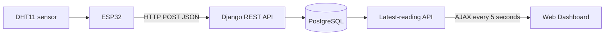

# 🌦️ IoT Weather Station

An IoT weather-monitoring project that collects readings from an **ESP32** device and displays them through a **Django web dashboard**. Sensor measurements are submitted to a Django REST API and stored in a **PostgreSQL** database.

**Repository:** https://github.com/csubham2370/iot_weather_station

## ✨ Features

- 🌡️ Receive and store temperature readings in °C
- 💧 Receive and store relative humidity readings in %
- 📡 Accept readings from an ESP32 over HTTP using a REST API
- 🗃️ Save device ID, measurements, and timestamps in PostgreSQL
- 📊 Display the most recent reading on a responsive Bootstrap dashboard
- 🔄 Automatically refresh the dashboard every **5 seconds** using jQuery AJAX
- 🧩 Expose an API endpoint for browser coordinates (location-name display is not currently enabled)

> **Current implementation:** The repository's Django model and dashboard actively support **temperature** and **humidity**. Pressure and stored location fields are commented out; they are not available in the current API response. The reverse-geocoding endpoint currently returns coordinates, not a readable location name.

## 🛠️ Technology Stack

| Layer | Technology |
| --- | --- |
| Microcontroller | ESP32 (external firmware; not included in this repository) |
| Sensor used in the project | DHT11 |
| Backend | Python, Django 6, Django REST Framework |
| Database | PostgreSQL |
| Frontend | HTML, Bootstrap 5, jQuery, AJAX |
| Location integration | Browser Geolocation API and OpenStreetMap Nominatim (partially implemented) |

## 🔄 System Workflow



1. An ESP32 reads temperature and humidity from a connected sensor.
2. The ESP32 sends a JSON request to the Django API over the network.
3. Django validates the payload with a serializer and saves it in PostgreSQL.
4. The dashboard requests the latest saved reading and displays it.

## 📁 Repository Structure

```text
iot_weather_station/
├── config/
│   ├── settings.py       # Django configuration and PostgreSQL environment variables
│   ├── urls.py           # Root URL configuration
│   ├── asgi.py
│   └── wsgi.py
├── weather/
│   ├── migrations/
│   ├── static/weather/js/
│   │   └── dashboard.js  # AJAX polling and browser geolocation
│   ├── templates/weather/
│   │   └── dashboard.html
│   ├── models.py         # WeatherReading model
│   ├── serializers.py    # DRF serializer
│   ├── views.py          # Dashboard and API views
│   └── urls.py           # Weather API routes
├── manage.py
└── README.md
```

## ✅ Prerequisites

- Python compatible with the project's Django version
- PostgreSQL server and an empty database
- `pip` and Python virtual environments
- ESP32 + suitable sensor and firmware if submitting readings from physical hardware

## 🚀 Local Installation

**1. Clone the repository**

```bash
git clone https://github.com/csubham2370/iot_weather_station.git
cd iot_weather_station
```

**2. Create and activate a virtual environment**

macOS/Linux:

```bash
python3 -m venv MyEnv
source MyEnv/bin/activate
```

Windows PowerShell:

```powershell
py -m venv MyEnv
.\MyEnv\Scripts\Activate.ps1
```

**3. Install dependencies**

The repository does not currently contain a `requirements.txt` file. Install the dependencies used by its Python source:

```bash
python -m pip install "Django>=6.0,<7.0" djangorestframework python-dotenv requests "psycopg[binary]"
```

**4. Configure PostgreSQL**

Create a PostgreSQL database and a `.env` file in the project root:

```dotenv
DB_NAME=iot_weather_station
DB_USER=your_postgres_user
DB_PASSWORD=your_postgres_password
DB_HOST=localhost
DB_PORT=5432
```

Keep `.env` out of version control because it contains credentials.

**5. Apply database migrations**

```bash
python manage.py migrate
```

**6. Start the server**

```bash
python manage.py runserver 0.0.0.0:8000
```

Open **http://127.0.0.1:8000/** on the computer hosting Django. To send data from an ESP32 on the same network, use the computer's LAN IP address in the device firmware, not `127.0.0.1`.

## 🔌 API Documentation

| Method | Endpoint | Purpose |
| --- | --- | --- |
| `GET` | `/` | Weather dashboard |
| `POST` | `/api/weather/` | Create a weather reading |
| `GET` | `/api/weather/latest/` | Retrieve the latest stored reading |
| `GET` | `/api/location/?lat=23.6739&lon=86.9524` | Return submitted coordinates after a reverse-geocoding request |

### Submit a Reading

```bash
curl -X POST http://127.0.0.1:8000/api/weather/ \
  -H "Content-Type: application/json" \
  -d '{"device_id":"ESP32_001","temperature":29.5,"humidity":72.4}'
```

Example of a successful response (IDs and timestamps vary):

```json
{
  "id": 1,
  "device_id": "ESP32_001",
  "temperature": 29.5,
  "humidity": 72.4,
  "created_at": "2026-10-10T10:00:00Z"
}
```

A valid submission returns HTTP **201 Created**. Invalid payloads return HTTP **400 Bad Request**.

### Retrieve the Latest Reading

```bash
curl http://127.0.0.1:8000/api/weather/latest/
```

The endpoint returns the most recently created reading. If there are no readings, it returns HTTP **404** with:

```json
{"message":"No weather data available"}
```

## 📟 ESP32 Integration

The ESP32 firmware should:

1. Connect to the same reachable network as the Django server.
2. Read temperature and humidity from the DHT11 sensor.
3. Send a JSON `POST` request to `http://<SERVER_LAN_IP>:8000/api/weather/`.
4. Check for HTTP `201` to confirm Django accepted the reading.

**Example payload:**

```json
{
  "device_id": "ESP32_001",
  "temperature": 33.8,
  "humidity": 75.0
}
```

> ESP32/Arduino sketch code is not included in the current GitHub repository. Device pin assignments, Wi-Fi credentials, and firmware upload steps depend on your hardware setup.

## 🖥️ Dashboard

The homepage uses a Bootstrap weather card to show:

- Latest temperature and humidity
- Device identifier
- Last updated timestamp
- Loading and error states

Weather readings are fetched with jQuery AJAX every five seconds, so the page updates without a full reload.

## 🔐 Deployment and Security Notes

The current settings are configured for development (`DEBUG=True`, permissive `ALLOWED_HOSTS`, and a hard-coded Django secret key). Before public deployment:

- Move `SECRET_KEY` to a protected environment variable and rotate the currently committed value.
- Set `DEBUG=False` and restrict `ALLOWED_HOSTS`.
- Add API authentication or device-specific access controls; the submission endpoint currently has no explicit device authentication.
- Configure HTTPS, database permissions, and production static-file serving.
- Keep database credentials and Wi-Fi passwords outside Git.

## 🧭 Potential Enhancements

- Enable barometric pressure support (e.g., BME280)
- Return and display reverse-geocoded location names
- Add historical charts and filtering by device
- Add out-of-range alerts and device authentication
- Include the ESP32 firmware and a reproducible `requirements.txt`

## 👨‍💻 Author

**Subham Chakraborty**  
GitHub: [@csubham2370](https://github.com/csubham2370)

---

*IoT Weather Station — connecting physical sensors with a Python/Django web application.*
